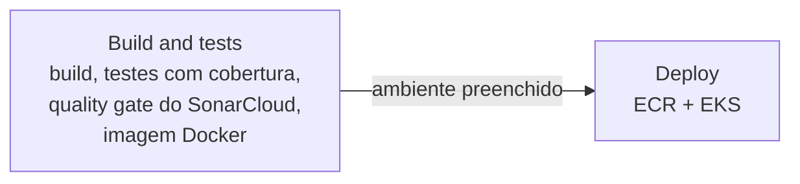

# Pipelines — Oficina Mecânica

Workflows reutilizáveis do GitHub Actions para os microsserviços da Fase 4 do Tech Challenge (FIAP SOAT, Grupo 160). Cada serviço chama o pipeline a partir do próprio repositório, com os próprios parâmetros, e dispara só com mudanças nele ([F4-08](https://github.com/tech-challenge-grupo-160/tech-challenge-oficina-mecanica/issues/139)).

| Serviço | Repositório |
|---|---|
| OS Service | [tech-challenge-oficina-mecanica](https://github.com/tech-challenge-grupo-160/tech-challenge-oficina-mecanica) |
| Billing | [tech-challenge-oficina-mecanica-billing](https://github.com/tech-challenge-grupo-160/tech-challenge-oficina-mecanica-billing) |
| Execução | [tech-challenge-oficina-mecanica-execucao](https://github.com/tech-challenge-grupo-160/tech-challenge-oficina-mecanica-execucao) |

## `servico-dotnet.yml`



| Job | Quando roda | O que faz |
|---|---|---|
| `Build and tests` | Sempre | Restore, build, testes com cobertura (artefatos `test-results` e `coverage-results`, resumo no job), análise e quality gate do SonarCloud e build da imagem. É o check obrigatório dos rulesets |
| `Deploy` | Só com `ambiente` preenchido, e só se o anterior passou | Imagem no ECR (`tc-grupo160-<amb>-<imagem>:<sha>`), Secret a partir do Secrets Manager, `kubectl apply -k` dos manifests e espera do rollout |

Teste vermelho ou quality gate reprovado não publica: o deploy depende do job de CI.

### SonarCloud

Com o segredo `SONAR_TOKEN` no repositório chamador, o job `Build and tests` analisa o código no [SonarCloud](https://sonarcloud.io/organizations/tech-challenge-grupo-160) e **falha se o quality gate reprovar** ([F4-09](https://github.com/tech-challenge-grupo-160/tech-challenge-oficina-mecanica/issues/140)). Sem o segredo, a análise é pulada com um aviso no job.

- **Quality gate:** "Sonar way", o único disponível no plano gratuito. Vale para o código novo (o diff do PR, ou o que mudou desde a versão anterior na branch): cobertura ≥ 80%, nenhum bug ou vulnerabilidade nova, duplicação ≤ 3% e security hotspots revisados.
- **Cobertura:** o coverlet gera Cobertura (resumo e artefatos) e OpenCover (SonarCloud, cujo scanner .NET não lê Cobertura). O pipeline força os dois formatos, independentemente do `coverlet.runsettings`.
- **Projeto:** chave `<dono>_<repositorio>`, o padrão da importação do GitHub. O projeto precisa estar com a análise por CI (Automatic Analysis desligada).

### Como chamar

```yaml
name: Pipeline

on:
  pull_request:
    branches: [develop, homolog, main]
  push:
    branches: [homolog, main]
  workflow_dispatch:
    inputs:
      ambiente:
        type: choice
        options: [desenvolvimento, homologacao, producao]

permissions:
  contents: read

jobs:
  pipeline:
    name: Pipeline
    uses: tech-challenge-grupo-160/tech-challenge-pipelines/.github/workflows/servico-dotnet.yml@v1
    with:
      servico: oficina-mecanica-billing
      solucao: Fiap.TechChallenge.OficinaMecanica.Billing.slnx
      imagem: billing
      regiao_aws: ${{ vars.AWS_REGION || 'us-east-1' }}
      # PR: so CI. Push na homolog/main: deploy no ambiente da branch.
      # Disparo manual: o ambiente escolhido (e assim que se publica em dev).
      ambiente: ${{ github.event_name == 'workflow_dispatch' && inputs.ambiente || (github.event_name == 'push' && (github.ref_name == 'main' && 'producao' || 'homologacao')) || '' }}
    secrets: inherit
```

O check obrigatório fica com o nome `Pipeline / Build and tests`.

### Entradas

| Entrada | Padrão | Para quê |
|---|---|---|
| `servico` | — | Nome no Kubernetes e no Datadog; também é o nome do Deployment |
| `solucao` | — | `.slnx`/`.sln` na raiz |
| `imagem` | — | Sufixo do repositório no ECR, criado pelo Terraform do `tech-challenge-infra-k8s` (`infra/ecr.tf`) |
| `ambiente` | vazio | `desenvolvimento`, `homologacao` ou `producao`; vazio = só CI |
| `dockerfile` | `docker/backend/Dockerfile` | |
| `runsettings` | `coverlet.runsettings` | Vazio = sem arquivo de configuração do coverlet |
| `regiao_aws` | `us-east-1` | |
| `namespace` | `oficina-mecanica` | |
| `deployment` | `servico` | Quando o Deployment tem outro nome |
| `manifestos_repositorio` / `manifestos_ref` / `manifestos_caminho` | próprio repositório, `develop`, `k8s` | Pasta com o `kustomization.yaml`; o placeholder `__AMBIENTE__` vira `dev`, `hom` ou `prod` |
| `segredos` | vazio | Um por linha: `CHAVE=id-do-segredo` ou `CHAVE=id-do-segredo#campo-json`; `{sufixo}` vira o ambiente |
| `nome_secret` | `<servico>-secret` | Nome do Secret do Kubernetes |
| `cluster_autoscaler` | `false` | Aplica o Cluster Autoscaler do `tech-challenge-infra-k8s` (só o OS Service) |
| `sonar_organizacao` | dono do repositório | Organização no SonarCloud |
| `sonar_projeto` | `<dono>_<repositorio>` | Chave do projeto no SonarCloud |
| `sonar_exclusoes` | vazio | Padrões fora da análise, separados por vírgula (ex.: `**/Migrations/**`) |

Credenciais, todas do repositório chamador com `secrets: inherit`: `AWS_ACCESS_KEY_ID`, `AWS_SECRET_ACCESS_KEY` e `AWS_SESSION_TOKEN`, publicados pelo `scripts/renova-secrets.sh` do `tech-challenge-oficina-mecanica`, e `SONAR_TOKEN`, cadastrado uma vez por repositório.

## Versionamento

Os serviços chamam a tag `v1`, que acompanha a última versão `1.x.y` publicada na `main`. Mudança compatível gera nova `1.x.y` e move a `v1`; mudança que quebra os chamadores (entrada removida ou renomeada) vira `v2`.

Fluxo de branches igual ao dos outros repositórios: `develop` → `homolog` → `main`, só por PR. O `Lint dos workflows` (actionlint) é obrigatório.
